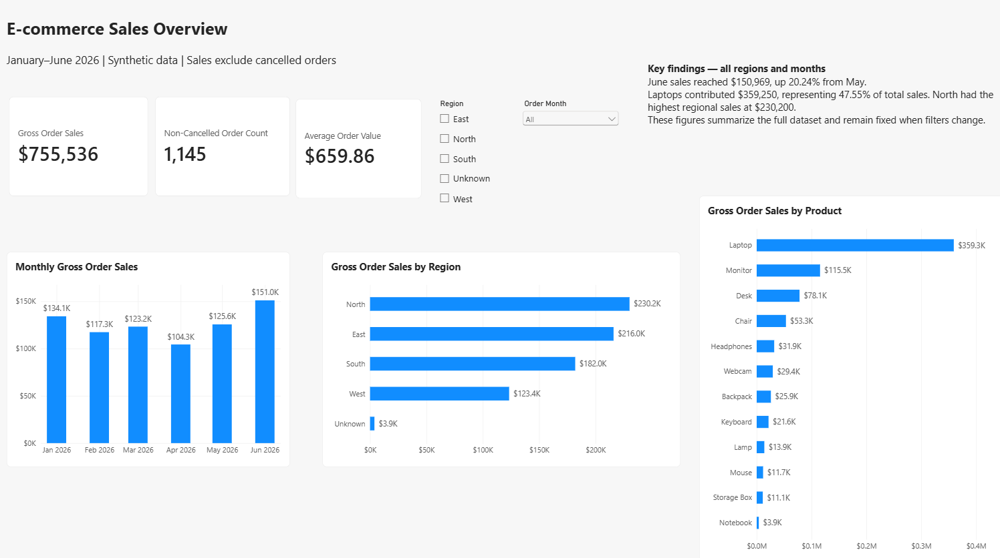
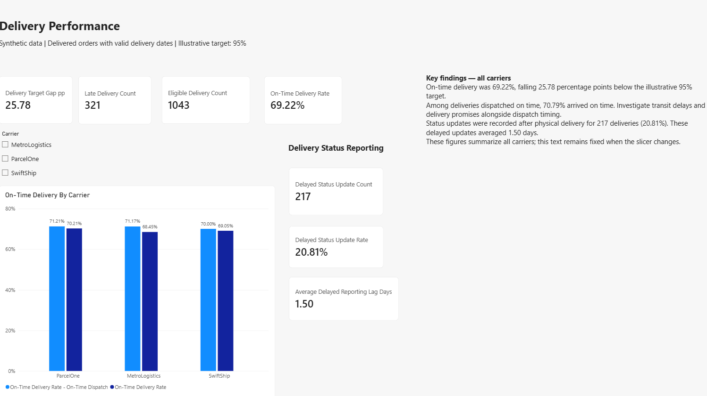

# E-commerce Sales and Delivery Analysis

A portfolio project analyzing synthetic e-commerce data for January–June 2026 using Excel, SQL, Python, and Power BI.

## Project Objective

Explore sales trends, identify leading products and regions, evaluate delivery reliability, and examine delays in delivery status reporting.

## Tools Used

- **Excel:** Data preparation, calculations, PivotTables, and data-quality tracking.
- **SQL Server through SQL Fiddle:** 15 analysis queries with saved execution screenshots.
- **Python:** Data cleaning, analysis, charts, and reconciliation checks.
- **Power BI:** Interactive Sales Overview and Delivery Performance dashboards.
- **Word:** Business Requirements Document and project summary.

## Dashboard Previews

### Sales Overview

### Delivery Performance

## Key Findings

- Sales excluding cancelled orders totaled **$755,536** across **1,145 orders**, with an average order value of **$659.86**.
- June sales reached **$150,969**, increasing **20.24%** from May.
- Laptops contributed **47.55%** of total sales.
- North led regional sales with **$230,200**.
- Of **1,043 eligible deliveries**, **722 arrived on time** and **321 arrived late**.
- The on-time delivery rate was **69.22%**, falling **25.78 percentage points** below the illustrative 95% target.
- **217 deliveries (20.81%)** had status updates recorded after physical delivery. These delayed updates averaged **1.50 days**.

## Data Preparation

- Removed one duplicate order-item record, reducing 2,428 rows to 2,427.
- Standardized carrier names.
- Retained missing regions as Unknown in Python and Power BI.
- Excluded one delivered order with a missing actual delivery date from delivery timing calculations.
- Reconciled key results across the analysis tools.

## Repository Contents

| File or folder | Contents |
|---|---|
| `Ecommerce_Working.xlsx` | Excel preparation, calculations, and PivotTables |
| `Ecommerce_Sales_Delivery_Analysis.ipynb` | Python analysis and validation |
| `Ecommerce_Sales_Delivery_Dashboard.pbix` | Power BI report |
| `SQL/` | Complete setup and analysis script, plus 15 query screenshots |
| `Documentation/` | BRD and project summary |
| `raw_data/` | Five source CSV files |
| Dashboard PNG files | Sales and delivery report previews |

## How to Explore

1. View the dashboard previews above.
2. Open the Python notebook and SQL script to review the analysis.
3. Review the BRD and project summary in Documentation.
4. Download the Excel workbook or Power BI report for further exploration.

Power BI Desktop is required to open the `.pbix` file. Local data paths may need updating before refreshing Power BI or rerunning the notebook.

## Limitations

The dataset is synthetic, and the 95% delivery target is illustrative. Sales represent non-cancelled order value, not confirmed payments or profit. Carrier comparisons identify patterns but do not establish causes.

Dashboard findings are static text and remain fixed when filters change. Recommendations have not been implemented, and no real business impact is claimed.

## Author

Harshitha
